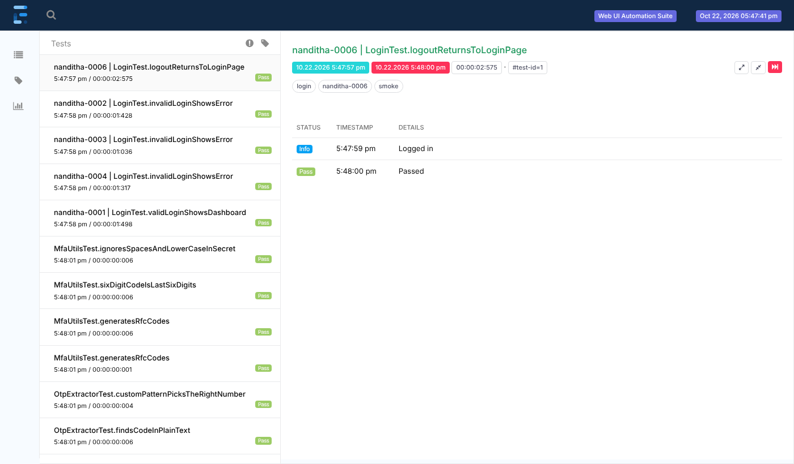

# webUI-test-automation-framework

[](https://github.com/nandithayerasani/webUI-test-automation-framework/actions/workflows/tests.yml)

-  This is a pure TestNG and Page Object Model based framework
-  Preferable for automation-heavy and technical-teams
-  Prefer plain-English scenarios? See the sister project [webUI-cucumber-bdd-framework](https://github.com/nandithayerasani/webUI-cucumber-bdd-framework), the Cucumber BDD version of the same framework



Why it is built this way: see [Design decisions](#design-decisions).

## Stack

Java 17, Maven, Selenium 4, TestNG, Log4j2, ExtentReports. Selenium Manager downloads browser drivers automatically, so no driver setup is needed.

## Project layout

```
src/main/java
  base/        DriverFactory (thread-safe driver, private mode), BrowserStack, BaseTest, BasePage
  constants/   FrameworkConstants (paths, defaults)
  pages/       Page objects: Login, Dashboard, Header, Footer, Settings (side menu)
  utils/       ConfigReader, WaitUtils, WindowUtils, AlertUtils, FileUploadUtils,
               MfaUtils, TestDataReader, ScreenshotUtil, LoggerUtil
  utils/email/ Email OTP readers: ImapOtpReader (Gmail/IMAP), GraphOtpReader (Outlook/M365)
src/test/java
  listeners/   TestListener (logging, Extent report, screenshot on failure)
  tests/       Test classes (tests/unit holds browser-free checks of the helpers)
src/test/resources
  config.properties, testng.xml, browserstack.json, log4j2.xml
  environments/ qa.properties, sit.properties, uat.properties (URL, data sheet per environment)
  testdata/    <env>/TestData.xlsx (test data sheet), files for upload tests
```

## Running

Only a JDK (17+) is needed. The Maven Wrapper downloads Maven on first use, so use `.\mvnw.cmd` on Windows or `./mvnw` on macOS/Linux in place of `mvn` if Maven is not installed.

```
mvn test                                        # uses config.properties
mvn test -Dbrowser=edge -Dprivate.mode=true     # Edge InPrivate
mvn test -Dbrowser=chrome -Dheadless=true
mvn test -Dexecution=browserstack               # needs BROWSERSTACK_USERNAME / BROWSERSTACK_ACCESS_KEY
```

Any key in `config.properties` can be overridden with `-Dkey=value`.

Reports: `reports/ExtentReport.html`. Failure screenshots: `reports/screenshots/`. Logs: `logs/automation.log`.

## Environments (QA, SIT, UAT)

Each environment has its own settings file and test data sheet:

```
src/test/resources/environments/qa.properties    base.url, testdata.file, ...
src/test/resources/environments/sit.properties
src/test/resources/environments/uat.properties
src/test/resources/testdata/qa/TestData.xlsx
src/test/resources/testdata/sit/TestData.xlsx
src/test/resources/testdata/uat/TestData.xlsx
```

Pick one with `env` (default `qa`, set in `config.properties`):

```
.\mvnw.cmd clean test -Denv=sit
.\mvnw.cmd clean test -Denv=uat
```

Settings are read in layers, each overriding the one before: `config.properties` (shared), then `environments/<env>.properties`, then `-Dkey=value` on the command line. So anything that differs per environment, such as the URL, the data sheet, a test username or a mailbox, goes in the environment file. To add an environment (e.g. `prod`), add `environments/prod.properties` and `testdata/prod/TestData.xlsx`. The pipelines have an environment choice too.

## CI pipelines

The pipeline files live in this repo so they are versioned together with the tests:

- `.github/workflows/tests.yml` for GitHub Actions. It runs headless on every push and pull request, and the badge at the top of this page shows the latest result. Start a run by hand from the Actions tab to choose the environment, browser and tags. The `reports` folder is uploaded with each run.
- `Jenkinsfile` for Jenkins. Point a Pipeline job at this repo with "Pipeline script from SCM". Set the JDK and Maven tool names to match your Jenkins (`JDK17`, `Maven3`). For BrowserStack, add a "Username with password" credential with id `browserstack-credentials`.
- `azure-pipelines.yml` for Azure DevOps. Create a pipeline from this file. For BrowserStack, add a variable group `browserstack` with secret variables `BROWSERSTACK_USERNAME` and `BROWSERSTACK_ACCESS_KEY`.

Both let you pick browser, private mode, headless, execution (local or BrowserStack) and the suite file when you start a run. They default to headless, since build agents have no screen. Test results show up in the pipeline's test tab, and the Extent report and screenshots are saved as build artifacts.

## Private / incognito mode

| Browser | Argument used |
|---------|---------------|
| Chrome  | `--incognito` |
| Edge    | `-inprivate`  |
| Firefox | `-private`    |

Ways to turn it on, from strongest to weakest:

1. `privateMode` parameter on a `<test>` in testng.xml
2. A browser-specific key in config, e.g. `edge.private.mode=true`
3. The global key `private.mode=true` (or `-Dprivate.mode=true`)

Extra browser arguments can be added per browser with `chrome.args`, `edge.args` and `firefox.args` (comma-separated).

## Writing a page object

Keep every XPath together in the Locators section at the top of the class, then the actions below:

```java
public class LoginPage extends BasePage {

    // ==================== Locators (XPath) ====================
    private static final By USERNAME_INPUT = xpath("//input[@id='user-name']");
    private static final By LOGIN_BUTTON   = xpath("//input[@id='login-button']");
    // Dynamic: fill %s at run time with xpath(ROW_BY_NAME, name)
    private static final String ROW_BY_NAME = "//tr[td[text()='%s']]";
    // ==========================================================

    public void clickLogin() {
        click(LOGIN_BUTTON);
    }
}
```

`BasePage` provides `click`, `type`, `getText`, `isDisplayed`, `selectByVisibleText`, `jsClick`, `scrollIntoView` and more, all with explicit waits built in.

## Helpers

| Helper | What it does |
|--------|--------------|
| `WaitUtils` | Explicit waits, including `waitForStable` for elements that slide or animate |
| `WindowUtils` | Switch to a new pop-up window or tab, switch by title or URL, close and return, open tabs, frames |
| `AlertUtils` | JavaScript `alert`, `confirm` and `prompt`: accept, dismiss, read text, type, accept only if present |
| `FileUploadUtils` | Uploads through `<input type="file">`, including hidden inputs and multiple files. Relative names come from `src/test/resources/testdata`. Works on BrowserStack too. `BasePage.uploadFile(...)` wraps it |
| `MfaUtils` | Generates authenticator-app (TOTP) codes from the account's MFA secret, waiting for a fresh code if the current one is about to expire |
| `ScreenshotUtil` | Screenshots as PNG bytes, saved under `reports/screenshots` |

Pop-up window example:

```java
String main = WindowUtils.getCurrentHandle();
click(OPEN_HELP_LINK);
WindowUtils.switchToNewWindow(main);
// ... work in the pop-up ...
WindowUtils.closeAndSwitchTo(main);
```

MFA example: when you enroll the test account, pick "can't scan the QR code" to see the secret key, and store it in the `MFA_SECRET` environment variable (or a pipeline secret). Then:

```java
type(MFA_CODE_INPUT, MfaUtils.getCode());
```

## Jira tags: running one test case

Every test carries its Jira ID as its first TestNG group, and data-driven rows use the Jira ID as their `TestCaseId` in the Excel sheet:

```java
@Test(groups = {"nanditha-0345", "smoke"})
public void userCanResetPassword() { ... }
```

Run only what you're working on with `-Dtags` (comma-separated, case doesn't matter, a leading `@` is fine):

```
.\mvnw.cmd test -Dtags=nanditha-0345               # one test
.\mvnw.cmd test -Dtags=nanditha-0002               # one Excel row of a data-driven test
.\mvnw.cmd test -Dtags=nanditha-0345,nanditha-0346 # several
.\mvnw.cmd test -Dtags=smoke                       # a whole group
```

If a data-driven test's own groups match a tag (e.g. `regression`), all its rows run. Otherwise only the rows whose `TestCaseId` matches. The Extent report puts the Jira ID in front of each test name. In VS Code you can also click the ▶ next to a single test method.

## Test data sheet

All test data lives in `src/test/resources/testdata/<env>/TestData.xlsx`, so it can be changed without touching code. There is one workbook per environment; the URL and the workbook to use come from `environments/<env>.properties`, and shared settings (browser, timeouts) from `config.properties`.

- One sheet per feature or page (`Login`, `Products`, ...). Row 1 holds the column names, and each row below is one test case.
- `TestCaseId` (column A) is the row's Jira ID, e.g. `nanditha-0002`. `Run` = `N` skips a row.
- Add any columns you need. Tests read values by column name.
- Keep real passwords and secrets out of the workbook. Use environment variables for those.

```java
Map<String, String> data = TestDataReader.getRow("Login", "nanditha-0001");
new LoginPage().loginAs(data.get("Username"), data.get("Password"));

@DataProvider(name = "invalidLogins")
public Object[][] invalidLogins(ITestNGMethod method) {   // TestNG passes the method in; used for -Dtags
    return TestDataReader.asDataProvider(method, "Login", row -> "invalid".equals(row.get("Scenario")));
}
```

## Email OTP codes

For apps that email a one-time code, the framework signs in to the mailbox, waits for the email and pulls the code out. It does not use the mailbox you are signed in to in your browser, since tests run in a fresh browser profile and pipelines have no browser login at all.

```java
Instant sent = Instant.now();          // just before the code is sent
click(SEND_CODE_BUTTON);
String otp = EmailOtpReaders.fromConfig().waitForOtp(
        OtpQuery.sentAfter(sent)
                .from("no-reply@myapp.com")
                .subjectContains("verification code"));   // optional: .otpPattern("code is (\\d{6})")
type(OTP_INPUT, otp);
```

Pick the mailbox type with `email.provider` and set `email.username` in `config.properties`:

| Provider | `email.provider` | Secrets (environment variables) | Setup |
|----------|------------------|----------------------------------|-------|
| Gmail or any IMAP mailbox | `imap` | `EMAIL_PASSWORD` | Gmail: turn on 2-Step Verification, then create an App password and use it here |
| Outlook / Microsoft 365 | `graph` | `GRAPH_TENANT_ID`, `GRAPH_CLIENT_ID`, `GRAPH_CLIENT_SECRET` | Azure app registration with the Microsoft Graph `Mail.Read` application permission (admin consent). Work/school mailboxes only |

Use a dedicated test mailbox, not a personal one.

## Writing a test

Extend `BaseTest`. A fresh browser opens on `base.url` before each test method and closes afterwards. Add the class to `testng.xml`.

## Design decisions

The choices below are deliberate. Each one says what was picked and why.

- **One driver per thread.** `DriverFactory` keeps the WebDriver in a `ThreadLocal`, so tests can run in parallel without sharing a browser, and page objects never receive a driver through their constructor.
- **Locators at the top of every page class.** Each page object starts with a "Locators (XPath)" block. When the UI changes, there is one place to look, and the methods below read like the user's actions.
- **Explicit waits only.** No implicit waits and no `Thread.sleep` in page code. Every wait for the UI goes through `WaitUtils`, and `waitForStable` handles animated elements such as the side menu, which was the cause of a real flaky click during development.
- **Configuration in layers.** `config.properties` holds the defaults, `environments/<env>.properties` holds what changes between QA, SIT and UAT (URL and data sheet), and `-Dkey=value` overrides either one. The same code runs locally, in CI and on BrowserStack, and only the settings change. An unknown environment fails fast instead of silently falling back.
- **Secrets stay out of the repo.** BrowserStack keys, the MFA secret and mailbox credentials are read from environment variables (`ConfigReader.getSecret`), so nothing sensitive is committed and CI tools can inject them from their own secret stores.
- **Test case IDs match Jira.** Tests are identified by Jira-style IDs such as `nanditha-0001`, and the same ID is the row key in the Excel data sheet. That makes it easy to run one case while writing it, and to trace a failure back to the ticket.
- **Optional features are easy to remove.** MFA, email OTP, Excel data, BrowserStack and each pipeline are separate files behind small interfaces. The table in [Removing what you don't need](#removing-what-you-dont-need) lists exactly what to delete for each one.
- **The helpers have unit tests.** The TOTP generator, OTP extraction and the Excel reader are covered by fast unit tests that need no browser, so a broken helper is caught before any UI test runs.
- **Pipelines live with the code.** Jenkins, Azure DevOps and GitHub Actions files are versioned in the same repo as the tests, so a change to how tests run is reviewed together with the tests.
- **Plain TestNG instead of Cucumber.** Tests are Java methods, which suits teams where the automation engineers own the tests. There is no Gherkin layer to maintain, and refactoring tools work across the whole suite. Jira IDs are TestNG groups, filtered by `TagFilter`.
- **ExtentReports for reporting.** It produces a single self-contained HTML file with the environment, browser and tags at the top and a screenshot embedded on failure, which is easy to attach to a build or a bug.

## Removing what you don't need

The framework ships with options for many setups. Delete the pieces your project doesn't use:

| If you don't need | Delete | Also |
|-------------------|--------|------|
| BrowserStack | `base/BrowserStack.java`, `src/test/resources/browserstack.json` | In `DriverFactory.initDriver`, replace the `browserstack` branch with `createLocalDriver(browser, options)`. Remove `execution` from config and the pipelines |
| Jenkins | `Jenkinsfile` | |
| Azure DevOps | `azure-pipelines.yml` | |
| GitHub Actions | `.github/workflows/tests.yml` | Remove the badge at the top of this README |
| Authenticator-app MFA | `utils/MfaUtils.java`, `tests/unit/MfaUtilsTest.java` | Remove `mfa.secret` from config and the class from testng.xml |
| Email OTP (all) | the `utils/email` folder, `tests/unit/OtpExtractorTest.java` | Remove the `angus-mail` dependency from pom.xml, the Email OTP section of config, and the class from testng.xml |
| Only Gmail/IMAP | `utils/email/GraphOtpReader.java` | Remove the `graph` case in `EmailOtpReaders` |
| Only Outlook | `utils/email/ImapOtpReader.java` | Remove the `imap` case in `EmailOtpReaders` and the `angus-mail` dependency |
| Excel test data | `utils/TestDataReader.java`, `testdata/<env>/TestData.xlsx`, `tests/unit/TestDataReaderTest.java` | Remove the `poi-ooxml` dependency and `testdata.file` from the environment files. Put the data back into the tests |
| File uploads | `utils/FileUploadUtils.java`, `testdata/sample-upload.txt` | Remove `uploadFile` from `BasePage` |
| The saucedemo sample | everything in `pages/` and `tests/LoginTest.java`, the sample sheets in `TestData.xlsx` | Replace with your own pages and tests, and set `base.url` in each `environments/<env>.properties` |

After deleting, run `.\mvnw.cmd clean test` to confirm everything still compiles.
